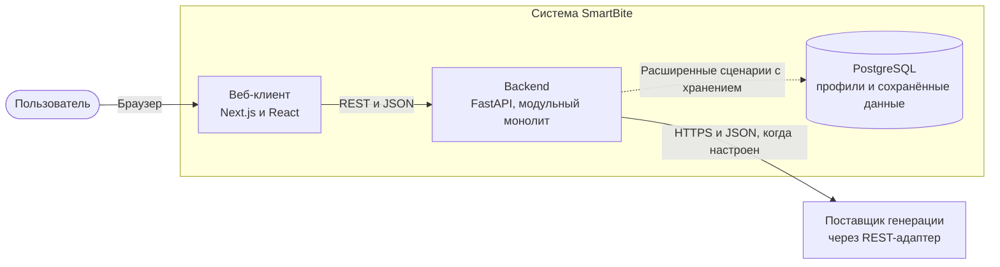
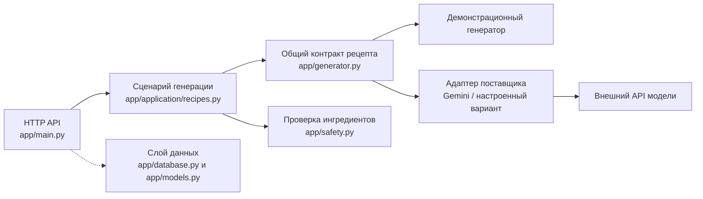
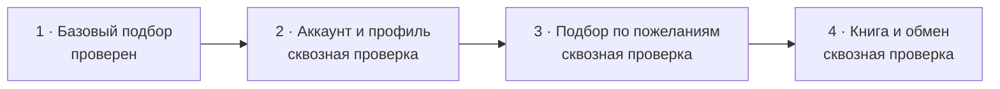

# Архитектура SmartBite: C4 и итерации продукта

Схемы показывают базовый сценарий подбора рецепта и устройство backend. Внешняя модель доступна через сервер, а разные интерфейсы используют общий сценарий генерации и проверки.

## C4, уровень контекста

Пользователь отправляет список продуктов и получает рецепт либо сообщение об ошибке. Сервис генерации получает продукты и возвращает черновик; SmartBite проверяет его состав и структуру до показа. В локальном демонстрационном режиме внешний генератор заменяется фиксированным ответом. Для базового запроса не требуются регистрация, профиль и сохранение результата.

## C4, уровень контейнеров

Пунктирная связь с PostgreSQL означает, что база используется функциями аккаунта и сохранения в развитой версии. Демонстрационный маршрут `/mvp` работает без чтения и записи пользовательских данных. Для первой итерации достаточно запустить фронтенд и backend; подключение PostgreSQL необходимо для сценариев с учётной записью и постоянным хранением.

## C4, уровень компонентов backend

Модули вызываются в одном процессе, по обычным вызовам функций. Backend ограничивает число одновременных генераций и время ожидания; брокера очередей нет. Для MVP API принимает список продуктов, сценарий вызывает генератор, проверяет структуру и состав рецепта, затем возвращает клиенту только прошедший проверку результат. При сбое, тайм-ауте, неполном ответе или отклонении рецепта возвращается ошибка без черновика.

## Связь с Iterative Enhancement

Iterative Enhancement выбран для развития продукта работающими итерациями. После каждой итерации анализируются результаты, уточняются требования и планируется следующее расширение.

На маршруте `/mvp` показан базовый сценарий подбора рецепта. В основной версии `/` есть наработки для следующих итераций; их сквозная проверка ещё впереди.

## Реализуемые компоненты и атрибуты качества

- `app/main.py` — HTTP-маршруты, в том числе узкий контракт демонстрационного MVP.
- `app/application/recipes.py` — сценарий подготовки рецепта, независимый от веб-клиента.
- `app/safety.py` — детерминированные проверки состава и ответа.
- `app/generator.py` — общий контракт рецепта, разбор JSON и демонстрационный генератор.
- `app/gemini_adapter.py` и другие адаптеры — вызов настроенного поставщика через сервер.
- `app/database.py`, `app/models.py` — хранение развитых пользовательских сценариев.

**Безопасность показа:** рецепт доступен клиенту только после проверок backend. Эти проверки не подтверждают отсутствие скрытых компонентов или перекрёстного загрязнения и не являются медицинской гарантией.

**Наблюдаемость:** backend добавляет идентификатор запроса и журналирует маршрут, код ответа и длительность. Содержимое запроса и ключи внешних сервисов в журнал не записываются.

**Расширяемость:** новый интерфейс может вызывать тот же сценарий через отдельный адаптер; замена модели ограничена её адаптером и настройками.

**Развёртывание:** backend — один модульный монолит. Внешний вызов модели выполняется синхронно с ограничениями параллельности и времени ожидания.

Подробные решения о модульном монолите, PostgreSQL и REST описаны в [ADR-001](ADR-001-modular-monolith.md), [ADR-002](ADR-002-postgresql.md) и [ADR-003](ADR-003-rest-and-sync-generation.md).
