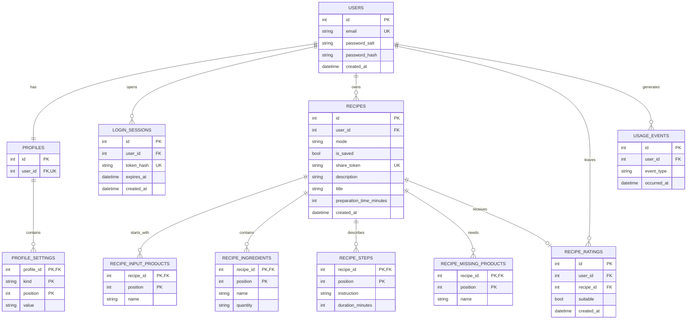
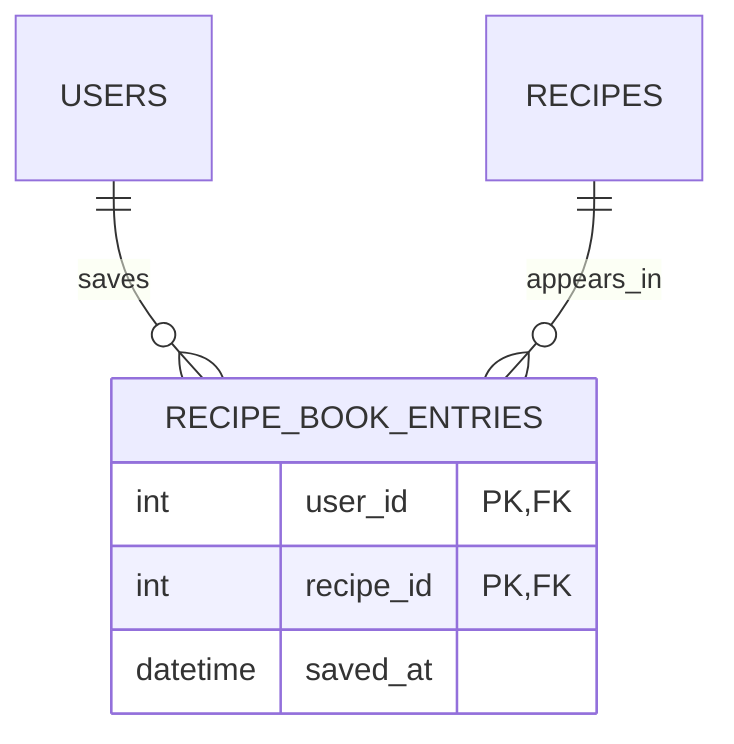

# Модель данных SmartBite

Демонстрационный сценарий `/mvp` работает без входа и базы данных: результат генерации не сохраняется. В основном интерфейсе и API есть регистрация и вход по электронной почте и паролю, история и книга рецептов; подтверждение адреса электронной почты пока не реализовано. Локально по умолчанию используется SQLite, а Docker и CI запускают приложение с PostgreSQL.

Ниже отдельно описаны схема сохранённых данных, уже представленная в коде, и целевая связь, которая позволит нескольким пользователям добавлять один общий рецепт в свои книги.

## Текущая модель сохранённых данных

У сохранённого рецепта один владелец — пользователь, который его создал. Владелец может создать много рецептов. Публичная ссылка позволяет другим людям открыть рецепт, но приложение не записывает таких читателей и не добавляет рецепт в их книги. Сейчас книга хранится флагом `recipes.is_saved` у самого рецепта, поэтому сохранить его может только владелец.

## Таблицы и ключи

| Таблица | Назначение и ключи |
| --- | --- |
| `users` | Учётная запись. `id` — первичный ключ, `email` уникален. |
| `profiles` | Один профиль на пользователя. `user_id` — внешний ключ и уникальный столбец. |
| `profile_settings` | По одному значению предпочтения или исключения в строке. Первичный ключ: `(profile_id, kind, position)`; `kind` ограничен значениями `preference` и `exclusion`. Позиция сохраняет исходный порядок. |
| `login_sessions` | Сессии пользователя. Хранится хеш токена; `token_hash` уникален. |
| `recipes` | Основные атрибуты рецепта и его владелец. Время приготовления может отсутствовать. |
| `recipe_input_products` | Продукты, указанные для запроса. Ключ `(recipe_id, position)`. |
| `recipe_ingredients` | Ингредиент и его количество. Ключ `(recipe_id, position)`; количество может отсутствовать. |
| `recipe_steps` | Текст шага и необязательная длительность. Ключ `(recipe_id, position)`. |
| `recipe_missing_products` | Продукты, которых не хватает для рецепта. Ключ `(recipe_id, position)`. |
| `recipe_ratings` | Оценка пригодности. Ограничение уникальности `(user_id, recipe_id)` оставляет одну актуальную оценку пользователя на рецепт. |
| `usage_events` | Событие пользователя и время события; текст запроса и список продуктов здесь не хранятся. |

В дочерних таблицах `position` нумерует строки внутри владельца, чтобы при чтении восстановить порядок продуктов, ингредиентов и шагов. Удаление пользователя каскадно удаляет его профиль, сессии, рецепты и события; удаление рецепта — его дочерние строки и оценку.

## Целевая модель общей книги

Чтобы несколько пользователей могли сохранить один и тот же рецепт, книгу нужно связать с рецептами через отдельную таблицу. В ней одна строка означает, что конкретный пользователь добавил конкретный рецепт в свою книгу. Первичный ключ `(user_id, recipe_id)` не даст добавить один рецепт в книгу пользователя дважды. `recipes.user_id` при этом останется ссылкой на автора рецепта, а `is_saved` будет заменён таблицей связей.

`recipe_book_entries` — целевое изменение; в текущей базе этой таблицы нет. Публичная ссылка и добавление в личную книгу остаются разными действиями: ссылка даёт доступ к просмотру, а строка в `recipe_book_entries` фиксирует сохранение пользователем.

## Нормализация

Модель приведена к 3НФ. Значения списков разложены на отдельные строки: каждая ячейка хранит одно значение (1НФ). Составные ключи дочерних таблиц включают владельца и позицию, а остальные поля зависят от всего ключа (2НФ). В таблицах нет полей, зависящих от других неключевых полей; например, название и количество ингредиента хранятся в строке, идентифицируемой рецептом и позицией (3НФ). Данные профиля не дублируются в рецептах, а данные владельца не копируются в строки ингредиентов.

ORM сохраняет удобное для приложения представление: поля `input_products`, `ingredients`, `steps`, `missing_products`, `preferences` и `exclusions` читаются и записываются как обычные списки. Это преобразование выполняется между объектами приложения и нормализованными таблицами; в БД массивов JSON для них нет.

## Проверки и обновление

Миграция `d7c4a1e82b90` переносит существующие списки профиля и рецептов в дочерние таблицы, сохраняя значения и порядок. Автоматические интеграционные тесты проверяют миграцию вперёд и назад на SQLite. Отдельные тесты PostgreSQL запускаются в CI и проверяют сохранение, восстановление порядка и ограничения связей в целевой СУБД.

При выдаче и сохранении рецепта backend проверяет его ингредиенты по активным исключениям. В текущей модели книга и оценки принадлежат владельцу рецепта. Целевая таблица связей расширит книгу так, чтобы пользователь мог сохранить полученный по ссылке рецепт в своей коллекции.
