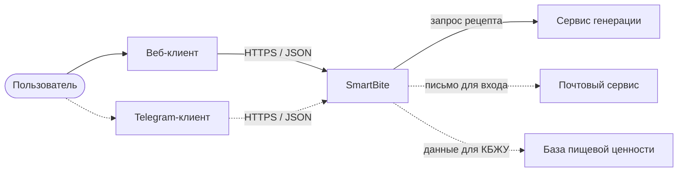
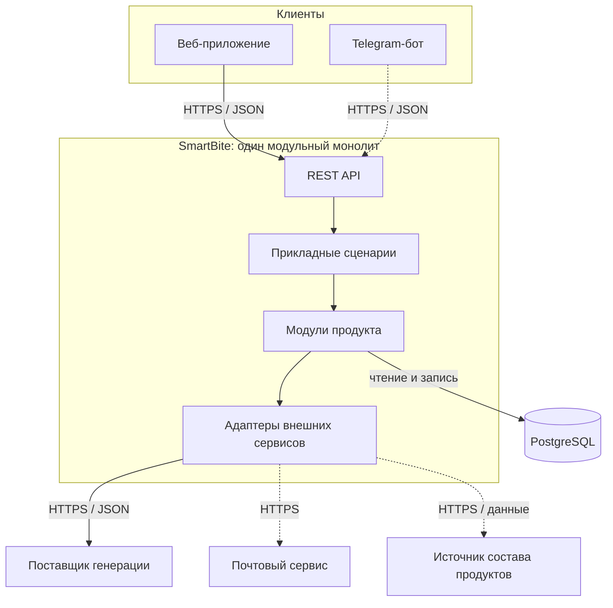
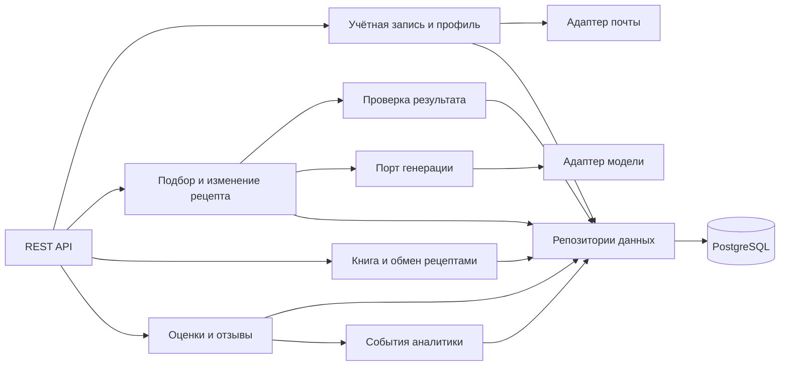
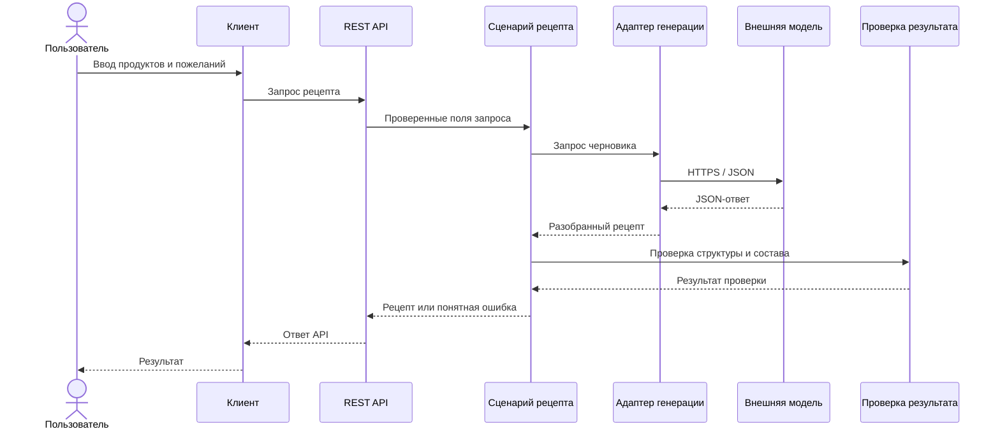
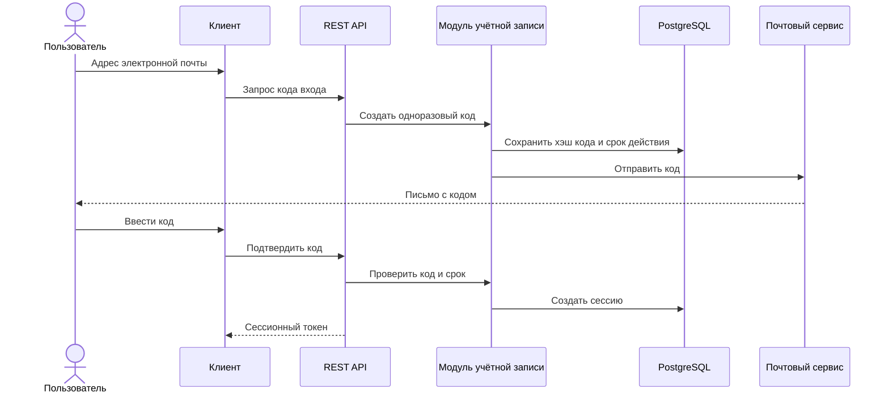
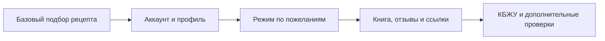

# Целевая архитектура SmartBite

Целевая архитектура показывает, как SmartBite может развиваться от подбора рецептов к профилю, книге рецептов и дополнительным сервисам. Новые возможности будут прорабатываться по мере развития продукта.

## Контекст системы

Сплошными линиями показан основной веб-сценарий и генерация рецепта. Пунктиром обозначены Telegram-клиент и внешние источники для будущих функций. Подключение этих возможностей будет прорабатываться отдельно.

## Контейнеры и внешние зависимости

Веб-клиент и Telegram-бот используют одни прикладные сценарии через REST API. Правила рецептов, работа с профилем и сохранение находятся в backend, а не дублируются в интерфейсах. Все модули backend работают в одном процессе.

## Основные модули backend

SmartBite проверяет рецепт до выдачи пользователю. Прикладной сценарий обращается к генератору через отдельный интерфейс, поэтому смена поставщика модели не требует менять правила продукта и формат ответа API. Исключения пользователя проверяются на сервере; ответ внешней модели сам по себе не подтверждает безопасность блюда.

## Потоки ключевых операций

### Подбор рецепта

### Вход по электронной почте

Одноразовый код имеет ограниченный срок действия и хранится в базе в виде хэша. Пользователю не нужно задавать пароль.

## Развитие по Iterative Enhancement

Целевая архитектура может опережать реализацию. В Iterative Enhancement работа начинается с полезного подмножества продукта, а затем повторяются проектирование, реализация и анализ. По результатам каждого цикла можно уточнять требования и архитектуру, расширять или перерабатывать уже работающие части.

Каждая следующая итерация уточняется по результатам предыдущей и расширяет работающий продукт.

## Архитектурные решения и ограничения

- **Backend:** модульный монолит с одним процессом и REST API. Telegram и другие клиенты подключаются как новые интерфейсы.
- **Хранение:** PostgreSQL для постоянных аккаунтов, профилей, рецептов и обратной связи. SQLite подходит для локального запуска и разработки.
- **Генерация:** серверный адаптер внешней модели; ключи не передаются браузеру. Ответ проверяется по контракту и правилам SmartBite.
- **Безопасность рецептов:** проверки названий и состава снижают риск неподходящего результата, но не подтверждают скрытые ингредиенты и перекрёстное загрязнение.
- **Почта:** отдельный адаптер отправляет одноразовый код или ссылку; проверку выполняет модуль учётной записи SmartBite.
- **КБЖУ:** будущий модуль использует источник пищевого состава и расчёт порции; модель генерации не является источником точных пищевых значений.
- **Аналитика:** события без текста запросов и секретов; состав набора событий и срок хранения задаются отдельно.
- **Обмен рецептами:** публичная ссылка содержит случайный токен; доступ к личному профилю и книге по ссылке не предоставляется.

Текущая C4-схема и технический статус MVP находятся в [c4.md](c4.md). Решения о монолите, PostgreSQL и синхронном REST-вызове описаны в [ADR-001](ADR-001-modular-monolith.md), [ADR-002](ADR-002-postgresql.md) и [ADR-003](ADR-003-rest-and-sync-generation.md).
